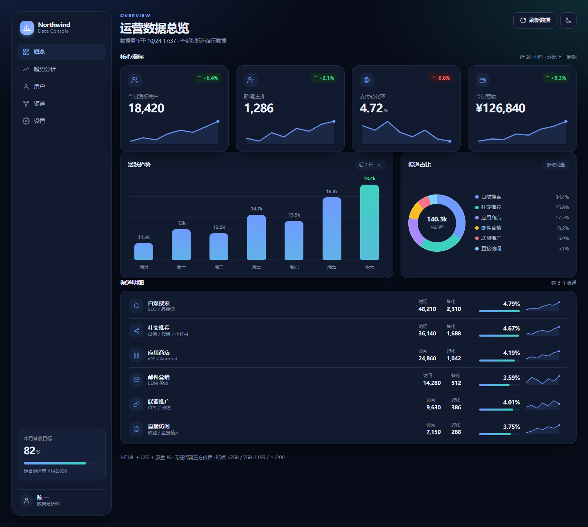
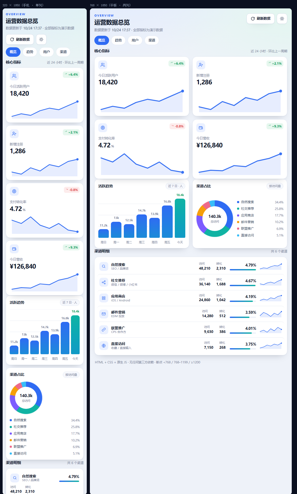
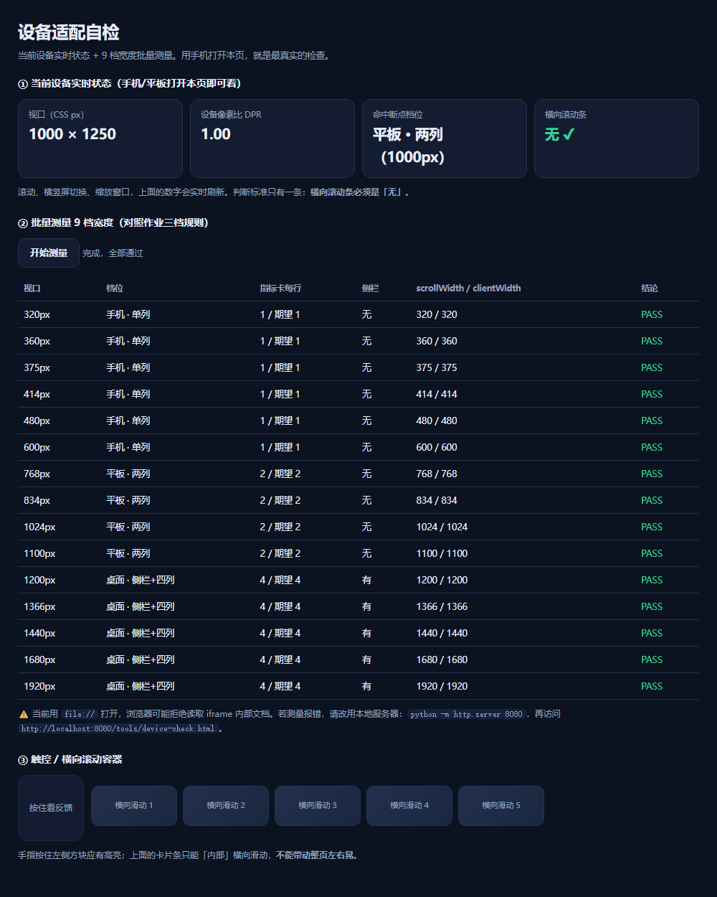

# 运营数据看板 · 响应式布局实现

一个用 **HTML + CSS + 原生 JavaScript** 实现的数据看板，无框架、无构建、无第三方依赖，双击 `index.html` 即可运行。

重点在于**三档断点的严格实现**：手机单列、平板两列、桌面侧栏 + 四列，320px ~ 1920px 全区间无横向滚动条。

---

## 预览

**桌面 1440px · 深色主题**



**手机 320px（左） / 平板 768px（右）**



**设备自检页**



---

## 三档断点

| 断点 | 布局 | 侧栏 | 指标卡 | 图表区 | 明细行 |
| --- | --- | --- | --- | --- | --- |
| `< 768px` 手机 | 单列堆叠 | 不渲染 | 1 列 | 1 列 | 两行排布，隐藏迷你折线 |
| `768 – 1199px` 平板 | 两列网格 | 不渲染 | 2 列 | 2 列 | 四栏单行 |
| `≥ 1200px` 桌面 | 侧栏 + 内容区 | 固定 sticky 侧栏 | 4 列 | 主次 1.55fr / 1fr | 四栏单行 |

实现位置（`assets/styles.css`）：

```css
.app { grid-template-columns: minmax(0, 1fr); }          /* 基础：单列 */
@media (max-width: 767.98px) { ... }                     /* 手机：强制单列 */
@media (min-width: 768px)  { ... }                       /* 平板：两列 */
@media (min-width: 1200px) { ... }                       /* 桌面：侧栏 + 四列 */
@media (min-width: 1600px) { ... }                       /* 超大屏：放大数字与图表 */
```

卡片网格使用自适应兜底，**没有任何固定大宽度**：

```css
.kpi-grid {
  grid-template-columns: repeat(auto-fit, minmax(min(100%, 220px), 1fr));
}
```

---

## 文件结构

```
html-plantform/
├── index.html              # 页面骨架（178 行）
├── assets/
│   ├── styles.css          # 设计令牌 + 组件 + 三档断点（821 行）
│   └── app.js              # 数据源 + 渲染 + 主题切换（330 行）
├── tools/
│   └── device-check.html   # 设备适配自检页（15 档宽度批量测量）
├── preview/                # 预览截图
├── PROMPT.md               # 可复用的实现提示词 + 验收记录
├── .gitignore
└── README.md
```

---

## 能力清单

| 要求 | 实现方式 |
| --- | --- |
| 三档断点 | `@media` 显式三档，另有 1600px 与 380px 两个细微兜底 |
| 无固定宽度 | `auto-fit` + `minmax()`，全区间无横向滚动 |
| 数据驱动 | 4 张指标卡、7 根柱子、6 条渠道均由 JS 数组 `map` 渲染，HTML 中无重复结构 |
| 数字不抖动 | `font-variant-numeric: tabular-nums`，刷新后数值变化但宽度恒定 |
| 主题切换 | CSS 变量 + `html[data-theme="dark"]`，`localStorage` 记忆，首次跟随系统 |
| 图标 | 34 个内联 SVG，`currentColor` + 显式 `width/height/viewBox` |
| 语义化 | `h1` / `h2` / `section` / 全部控件为 `<button>`，含 `aria-label`、skip link、焦点环 |
| 图表 | 柱状图纯 CSS（`--h` 变量算高度）、环形图 `conic-gradient`、迷你折线手写 SVG path |

**交互**：刷新数据（重新抖动并整体重渲染）、深浅色切换、移动端模块胶囊切换。
**无障碍**：`role="img"` + 动态 `aria-label` 描述图表数据、`prefers-reduced-motion` 降级。

---

## 运行

### 直接打开

双击 `index.html`。所有功能（除自检页的 iframe 测量）在 `file://` 下均可正常使用。

### 本地服务器（手机上验证推荐）

```bash
cd html-plantform
python -m http.server 8080
```

- 电脑访问 `http://localhost:8080`
- 手机连同一 WiFi，访问 `http://<电脑局域网IP>:8080`

---

## 验证响应式

三个层次，由快到真：

**1. 自检页（一键量化）**

打开 `tools/device-check.html`，点「开始测量」。它会用 iframe 跑 15 档宽度（320 → 1920），逐行比对：

- 指标卡每行数量是否符合该档预期
- 侧栏是否只在 ≥1200px 出现
- `scrollWidth` 是否等于 `clientWidth`（即无横向溢出）

实测 15 档 **全部 PASS**：

| 视口 | 卡数 | 侧栏 | 溢出 | 结论 |
| --- | --- | --- | --- | --- |
| 320 / 360 / 375 / 414 / 480 / 600 | 1 | 无 | 无 | PASS |
| 768 / 834 / 1024 / 1100 | 2 | 无 | 无 | PASS |
| 1200 / 1366 / 1440 / 1680 / 1920 | 4 | 有 | 无 | PASS |

**2. Chrome DevTools 设备模式**

`F12` → `Ctrl+Shift+M` → 依次选 iPhone SE / iPhone 14 Pro Max / iPad mini / iPad Pro，每档只查三件事：横向滚动条、指标卡列数、刷新数据时数字是否抖动。

**3. 真机**

手机浏览器打开本地服务器地址，横竖屏各看一遍，重点确认：首屏不需左右拖动、切横屏后列数变化、双指放大后文字不溢出卡片。

---

## 说明

- 数据为演示用随机数据，刷新按钮会重新生成；所有业务数字集中在 `assets/app.js` 顶部的 `SEED` 对象，替换即可接入真实接口。
- 支持 `?theme=dark` / `?theme=light` 强制指定主题，便于截图与分享。
- 完整实现提示词（可交给 AI 复现本项目）见 [PROMPT.md](PROMPT.md)。
